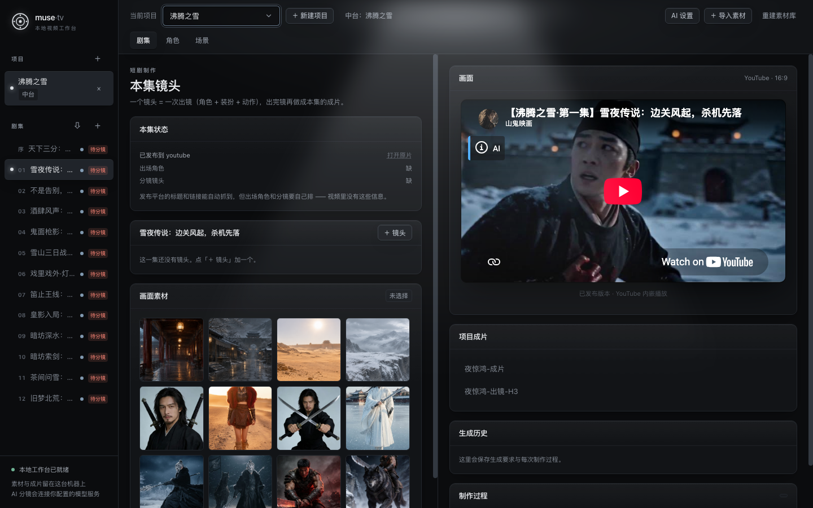
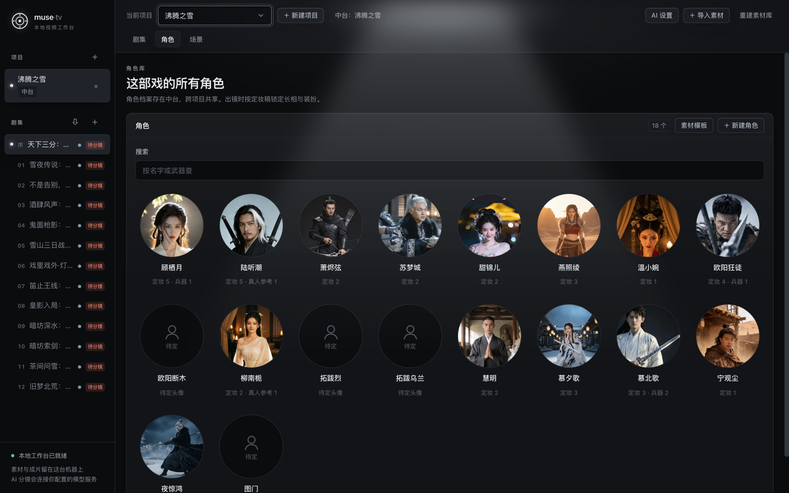
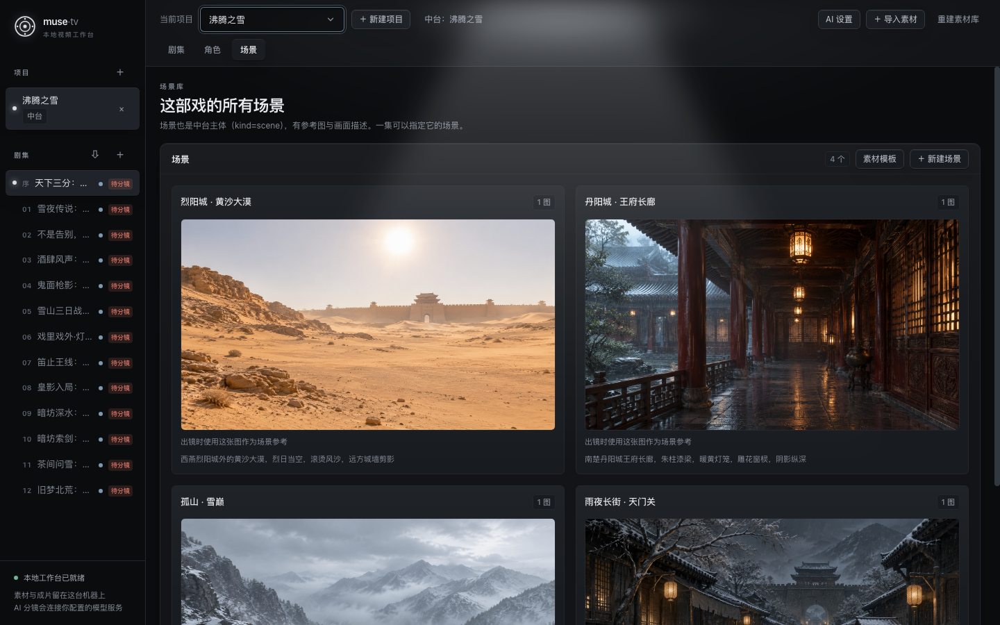

# muse·tv

**A local workbench for short dramas and short videos. Episodes, characters and scenes live in one project; assets and finished videos stay on your machine.**

muse·tv is a macOS desktop app. A short-drama project can hold a dozen episodes, dozens of characters and several scenes, each in its own library instead of one mixed pile. For a simple one-off clip, use a "short video" project.

[Download for macOS Apple Silicon](https://github.com/museav-ai/muse-tv/releases/download/app-v1.9.0/muse-tv-1.9.0-darwin-arm64.zip) · [Release notes](https://github.com/museav-ai/muse-tv/releases/tag/app-v1.9.0) · [Website](https://museav-ai.github.io/muse-tv/) · [中文](README.md)

## A look inside



*1.9.0 episode workspace, using the published short drama "Boiling Snow": 13 episodes imported from a YouTube channel and played inside the app.*

| Character library | Scene library |
|---|---|
|  |  |

## The drama made with it: "Boiling Snow"

This short drama was produced with muse-tv —— 13 集、4 个场景、13 characters, all inside one project.

[](https://www.youtube.com/watch?v=stNWoECC9NY)

*Prologue "天下三分：这场雪，开始沸腾" — watch all  13 episodes on YouTube*

| Ep. | Title |
|---|---|
| 序 | [天下三分：这场雪，开始沸腾](https://www.youtube.com/watch?v=stNWoECC9NY) |
| 01 | [雪夜传说：边关风起，杀机先落](https://www.youtube.com/watch?v=1r8_JSdrLiU) |
| 02 | [不是告别，是江湖开场｜小师妹下山](https://www.youtube.com/watch?v=qzlEaFfdk3w) |
| 03 | [酒肆风声：一碗阳春面，听尽三杰名号](https://www.youtube.com/watch?v=yOoyG8hNZcc) |
| 04 | [鬼面枪影：不报姓名，只等欧阳狂徒](https://www.youtube.com/watch?v=il-ag2QbE80) |
| 05 | [雪山三日战：天下第一](https://www.youtube.com/watch?v=DqGLZVfFlgk) |
| 06 | [戏里戏外·灯火疑城](https://www.youtube.com/watch?v=g7JNUd0vDSg) |
| 07 | [笛止王线：江湖深水](https://www.youtube.com/watch?v=lk6pi4fGY18) |
| 08 | [皇影入局：黑市开门](https://www.youtube.com/watch?v=BkJEJuWC4-8) |
| 09 | [暗坊深水：夜惊鸿](https://www.youtube.com/watch?v=99chg2_Lx-Q) |
| 10 | [暗坊索剑：孤山惊榜，王府风紧](https://www.youtube.com/watch?v=lZfdplPH4JE) |
| 11 | [茶间问雪：和尚入局，狂刀还生](https://www.youtube.com/watch?v=lTnn7C5oygA) |
| 12 | [旧梦北荒：兵锋将至](https://www.youtube.com/watch?v=AMhECm-PVsg) |

Every episode plays inside the app. Episode status spells out what is still missing (cast, storyboard); missing parts are never invented.

## Project types

You pick the type when creating a project, and it cannot be changed later. Each type has its own workspaces:

| Type | Workspaces | Good for |
|---|---|---|
| Short drama | Episodes / Characters / Scenes | Multi-episode series with many characters |
| Short video | Assets & production | Single clips: person or product intros, simple explainers |

## What it does

### Episodes

- Episodes contain shots. A prologue is numbered 0 and listed first.
- Import published episodes from a YouTube channel. Titles, links and videos come along, and the episode plays inside the app. Importing again updates existing episodes instead of adding duplicates.
- Each episode states what is still missing. Cast and storyboard cannot be read from a video, so imported episodes are marked "storyboard pending". You fill that in; the app does not invent it.

### Character and scene libraries

- Each character has its own avatar, costume art, turnarounds, and weapons & props. Typing `@CharacterName` in a shot description selects that character.
- Real-person photos are kept as "real-person reference" in a separate section and never used as a character avatar. A character is the person who appears in the drama, not the actor in a reference photo.
- Assets are classified by name. See the [asset classification SOP](apps/reel-studio-wails/docs/asset-classification.md) (Chinese).
- Built-in asset templates: five-view and three-view turnarounds, costume art, avatar, weapon, scene reference. Generate a batch in one click; results are named and filed by the rules. Generation costs money.
- Characters, scenes and reference images are snapshotted locally and still show up when MUSE AV is unreachable.

### Short-video production

Each line of script is one shot. The app generates Chinese voice-over locally, line by line, times the visuals to the speech, and renders an MP4 in portrait **1080 × 1920** or landscape **1920 × 1080**. If the narration does not fit the clip, you get an error asking you to cut it; the app will not stretch the picture or speed up the voice.

## First run

1. **Set up AI**: on first launch you are guided to sign in to MUSE AV (default) or enter your own model service (direct). You can switch between them in settings at any time.
2. **Create a project**: choose "short drama" or "short video" and name it. Projects are stored locally by default.
3. **Short drama**: create episodes, prepare assets in the character and scene libraries, then lay out shots for each episode. Published episodes can be imported from YouTube.
4. **Short video**: write the script, choose an aspect ratio, import images, click "Start", then export the MP4.

## AI services

| Mode | Notes |
|---|---|
| MUSE AV (default) | Sign in with a MUSE AV account; characters and scenes sync from a MUSE AV project |
| Direct | Enter an OpenAI-compatible base URL, model ID and API key; MiniMax H3 models are detected and their API is adapted |

- Keys are stored in the macOS Keychain.
- Storyboard drafts, image generation and video generation send requests to the selected service and may cost money. If a task was submitted but no receipt came back, the app does not retry automatically, to avoid being billed twice.

## Download and install

| Platform | Status |
|---|---|
| macOS Apple Silicon (M-series) | [Download 1.9.0 ZIP](https://github.com/museav-ai/muse-tv/releases/download/app-v1.9.0/muse-tv-1.9.0-darwin-arm64.zip), requires macOS 13 or later |
| Windows | No package for this version yet |
| macOS Intel | No package for this version yet |

Unzip and move `muse-tv.app` into Applications. This build is **ad-hoc signed and not notarized by Apple**, so macOS may block the first launch. If it does:

```bash
xattr -dr com.apple.quarantine /Applications/muse-tv.app
```

The [release page](https://github.com/museav-ai/muse-tv/releases/tag/app-v1.9.0) has SHA256SUMS and build info. Installation is manual; there is no auto-update.

## Before you start

- **Data stays local**: projects, assets and videos live in `~/.reel-kit/studio-desktop/`. Asset file names keep the original name, so if the ledger is lost, "Rebuild asset library" can recover entries from disk.
- **Deleting a project deletes its asset files.** Other projects are not affected.
- **Nothing reruns silently**: unfinished tasks are marked interrupted after a restart and are not resubmitted.

If something fails, check the error under "Production steps" first. When reporting, include the app version, macOS version and steps to reproduce, remove private paths from error text, and open an [issue](https://github.com/museav-ai/muse-tv/issues/new/choose).

## For developers

The desktop app is Wails + Go with no Node runtime. Offline Chinese TTS, a Chrome renderer and ffmpeg ship inside the package.

- [Desktop source](apps/reel-studio-wails) · [Build, test and release](docs/desktop-release.md) · [UI design notes](apps/reel-studio-wails/DESIGN.md)
- [Acceptance checklist](docs/acceptance.md): how each item was verified, the result, and what is not verified yet (Chinese)
- [CLI and engine docs](docs/cli.md)

## License

MIT
