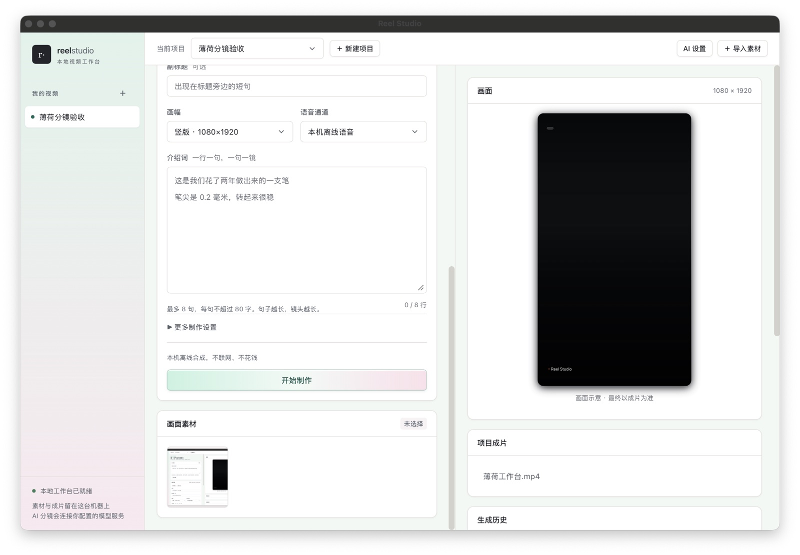
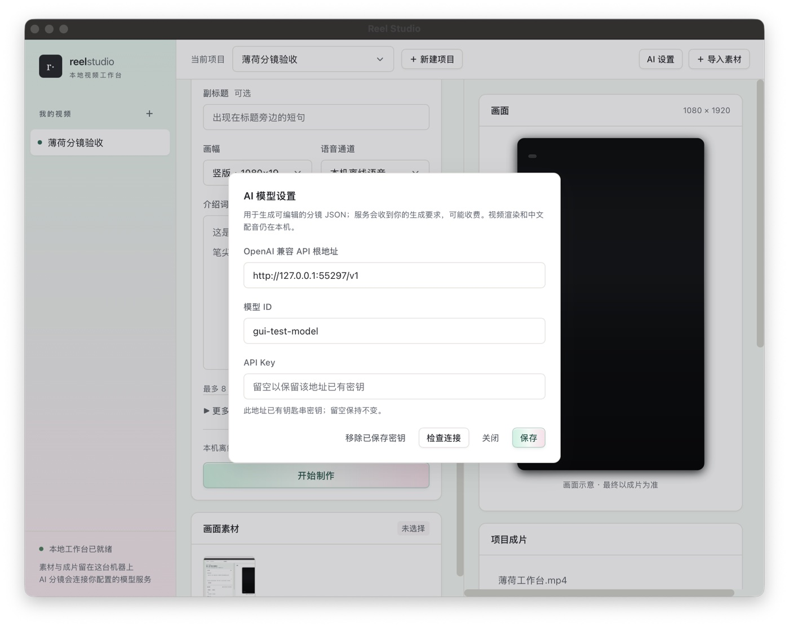

# Reel Studio

**把几句文案和图片，做成一支带中文配音的短视频。**

Reel Studio 是本地桌面视频工作台，适合制作人物介绍、商品介绍和简单的图文讲解短片。写文案、选画幅、配图片，在同一个窗口里制作、播放并导出 MP4。

[下载 macOS Apple Silicon 版](https://github.com/webkubor/reel-kit/releases/download/app-v1.7.0/reel-studio-1.7.0-darwin-arm64.zip) · [发布说明](https://github.com/webkubor/reel-kit/releases/tag/app-v1.7.0) · [官网](https://webkubor.github.io/reel-kit/)

## 界面一览

*1.7.0 实际桌面截图：制作与素材工作区。编辑画面用于示意，生成后可在同一区域播放真实成片。*

| 工作区 | 在这里做什么 |
|---|---|
| 左侧「我的视频」 | 按项目整理素材、生成记录和成片，切换不同视频任务 |
| 中间编辑区 | 写标题和逐句文案，切换表单或分镜 JSON，选择画幅、运镜与句间停顿 |
| 「画面素材」 | 导入图片，选作短片画面，也可以在应用内查看原图 |
| 右侧「画面 / 项目成片」 | 查看编辑示意、播放生成的视频、找回历史 MP4 并导出 |
| 「生成历史 / 制作过程」 | 查看生成要求、分镜文案、步骤状态、耗时与失败原因 |
| 顶栏「AI 设置」 | 配置自己的模型服务，用文字要求生成可编辑分镜 |

## 能做什么

### 从文案到短片

一行文案就是一个镜头。应用在本机逐句生成中文配音，按语音时长安排画面，再合成为视频。支持竖版 **1080 × 1920** 和横版 **1920 × 1080**，可选择轻缓运镜、淡化转场和句间停顿。

图片是可选的：导入后可用于画面，没有图片时使用占位画面。制作中可以取消，完成后直接在应用内播放和导出，无需另开播放器。

### AI 帮你起草分镜，你来审阅

填写「视频生成要求」，点击「生成分镜」，结果会进入编辑器。可以在表单里改标题和文案，也可以切到「分镜代码」编辑 JSON；确认内容后再点「开始制作」。

AI 负责生成文案与分镜数据，视频画面、配音和合成使用本机素材与制作引擎。分镜代码是可编辑数据，不执行 JavaScript 或系统命令。

### 看得见过程，也找得回结果

「生成历史」保留提示词与分镜内容；AI 任务分别记录请求模型和实际模型回执，回执缺失时显示 `unknown`。制作步骤会显示状态、耗时和错误，失败后可以查看原因再决定是否重试。历史成片保存在项目中，可以重新播放或导出。

## 第一次使用

1. **新建项目**：点击顶栏「新建项目」，为视频起一个名字。
2. **准备内容**：填写标题和介绍词，每行一句；也可以先配置 AI，再生成分镜。最多 8 句，每句最多 80 字。
3. **选择画面**：导入图片、选择横版或竖版，需要时展开「更多制作设置」。
4. **制作并导出**：点击「开始制作」，在右侧查看工序和成片，再用「导出成片」保存 MP4。

中文配音与视频制作在本机离线完成，不按调用计费。使用 AI 分镜是可选步骤，不配置 AI 也可以手动写文案、制作视频。

## 配置 AI

*截图中的地址和模型为本机测试示例，不是应用预置服务；使用时填写自己的服务信息。*

打开右上角「AI 设置」，填写 **OpenAI 兼容 API 根地址**（通常以 `/v1` 结尾）、**模型 ID** 和 **API Key**，保存后点击「检查连接」。

- 密钥存放在系统钥匙串；切换服务地址不会复用原地址的密钥。
- 「检查连接」只读取模型列表，不提交生成任务。
- 点击「生成分镜」才会把生成要求发送给你配置的服务，可能产生费用。应用不自动重试；取消请求不保证撤销云端已经发生的费用。

## 下载与安装

| 平台 | 当前发布状态 |
|---|---|
| macOS Apple Silicon（M 系列芯片） | [下载 1.7.0 ZIP](https://github.com/webkubor/reel-kit/releases/download/app-v1.7.0/reel-studio-1.7.0-darwin-arm64.zip)，需要 macOS 13 或更新 |
| Windows | 尚未发布本版安装包 |
| macOS Intel | 尚未发布本版安装包 |

解压后将 `Reel Studio.app` 放入应用程序目录。当前包为 **ad-hoc 签名、未 Apple 公证**，macOS 可能拦截首次启动。[发布页](https://github.com/webkubor/reel-kit/releases/tag/app-v1.7.0)提供 SHA256SUMS 与构建信息。

采用手动下载安装，暂不支持自动升级和旧项目自动迁移；旧项目数据不会被删除。

## 使用前了解

- **数据留在本机**：项目、素材和成片保存在 `~/.reel-kit/studio-desktop/`。只有主动使用 AI 分镜时，生成要求才会发给所配置的服务。
- **草稿尚未持久保存**：项目间切换会保留当前进程内的编辑内容，退出应用后未提交的草稿会丢失。已生成的素材、成片与任务记录会保存。
- **当前适合简单介绍短片**：没有通用时间线剪辑、云 TTS、声音克隆或 AI 图片/视频素材生成入口。
- **任务不会悄悄重跑**：重启后未完成的任务标为中断，不自动重新提交。

制作失败时先查看「制作过程」中的错误。反馈时提供应用版本、系统和复现操作，移除错误文本中的私人路径后提交 [Issue](https://github.com/webkubor/reel-kit/issues/new/choose)。

## 开发者入口

桌面应用使用 Wails + Go，不携带 Node 运行时、不启动本地 HTTP 业务服务。离线中文语音、Chrome 渲染器与 ffmpeg 随包提供。仓库同时保留独立 CLI/库，其能力和运行环境与桌面版分开。

- [桌面源码](apps/reel-studio-wails) · [构建、测试与发版](docs/desktop-release.md) · [界面设计约定](apps/reel-studio-wails/DESIGN.md)
- [命令行与引擎文档](docs/cli.md)
- [视频合成笔记](docs/video-compositing-notes.md)
- [知识短视频生产指南（CLI）](docs/knowledge-video-guide.md)

## License

MIT
