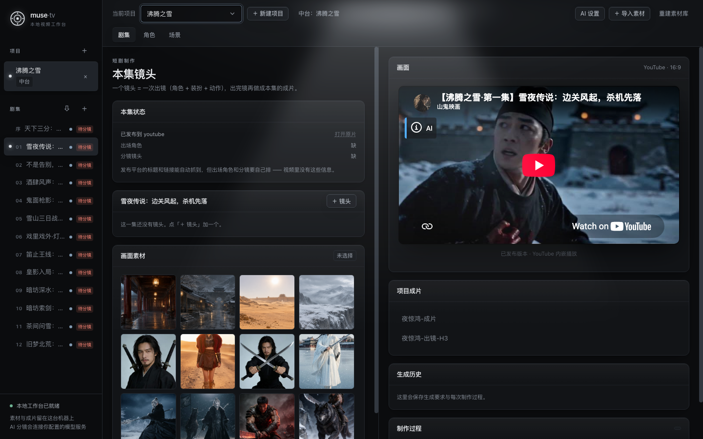
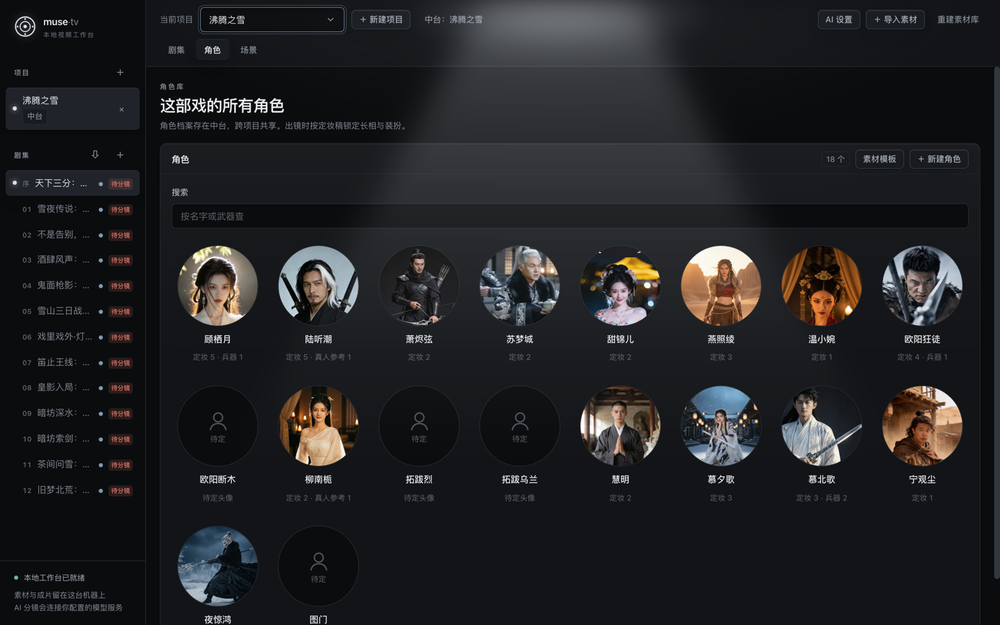
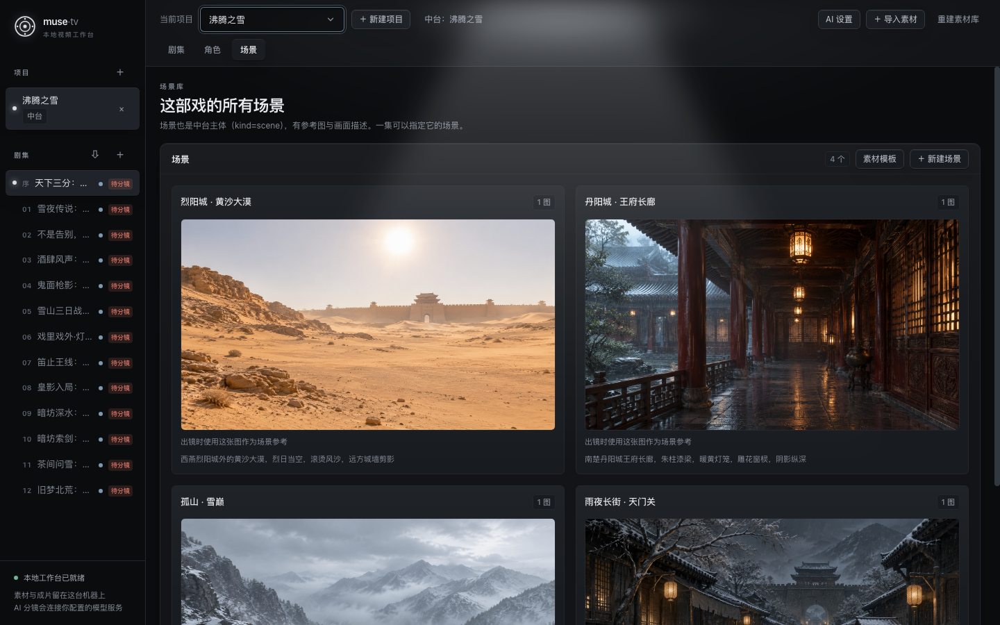

# muse·tv

**本地短剧与短视频工作台：项目里管剧集、角色与场景，素材和成片都留在这台机器上。**

muse·tv 是 macOS 桌面应用。一个短剧项目可以有十几集、几十个角色和若干场景，每样东西各有各的库，不混在一起；做简单的介绍短片时，用「短视频」项目即可。

[下载 macOS Apple Silicon 版](https://github.com/museav-ai/muse-tv/releases/download/app-v1.9.0/muse-tv-1.9.0-darwin-arm64.zip) · [发布说明](https://github.com/museav-ai/muse-tv/releases/tag/app-v1.9.0) · [官网](https://museav-ai.github.io/muse-tv/)

## 界面一览

*1.9.0 剧集工作区，数据来自已发布的短剧《沸腾之雪》：13 集从 YouTube 频道导入，应用内直接播放。*

| 角色库 | 场景库 |
|---|---|
|  |  |

## 项目类型

新建项目时选类型，之后不能改。不同类型有不同的工作区：

| 类型 | 工作区 | 适合 |
|---|---|---|
| 短剧 | 剧集 / 角色 / 场景 | 多集、多角色的连续剧集 |
| 短视频 | 素材与制作 | 人物介绍、商品介绍、图文讲解等单支短片 |

## 能做什么

### 剧集

- 按集管理，每集下面是镜头；序章编号为 0，排在最前。
- 可以从 YouTube 频道导入已发布的剧集，标题、链接和视频会自动带上，应用内直接播放。重复导入只更新，不会多出新的一集。
- 每集都会写明还缺什么。视频里拿不到「出场角色」和「分镜」，所以导入的剧集会标「待分镜」，这部分要自己补，应用不会替你编。

### 角色库与场景库

- 每个角色有自己的头像、定妆立绘、三视图、兵器与道具。在镜头描述里写 `@角色名` 会自动选中这个角色。
- 真人照片只算「真人参考」，单独放一栏，不会被当成角色头像。角色指的是剧里出场的那个人，不是参考照里的演员。
- 素材按命名自动分类，规则见 [素材分类 SOP](apps/reel-studio-wails/docs/asset-classification.md)。
- 内置素材模板：角色五视图、三视图、定妆立绘、头像、兵器图、场景参考。一键批量出图，按规则命名归位（出图会产生费用）。
- 角色、场景和参考图都在本机存了快照，连不上 MUSE AV 时照常显示。

### 短视频成片

一行文案就是一个镜头。应用在本机逐句生成中文配音，按语音时长安排画面，合成竖版 **1080 × 1920** 或横版 **1920 × 1080** 的 MP4。旁白念不完会直接报错并提示删减，不会拉长画面或加速念白。

## 第一次使用

1. **配置 AI**：首次打开会先引导你登录 MUSE AV（默认），或者填写自己的模型服务（直连）。两种方式随时可以在设置里切换。
2. **新建项目**：选「短剧」或「短视频」，起个名字。项目默认存在本机。
3. **短剧**：建集 → 在角色库、场景库里准备素材 → 给每集排镜头。已经发布过的剧集可以直接从 YouTube 导入。
4. **短视频**：写文案，选画幅，导入图片，点「开始制作」，然后导出 MP4。

## AI 服务

| 方式 | 说明 |
|---|---|
| MUSE AV（默认） | 用 MUSE AV 账号登录，角色与场景主体同步自 MUSE AV 项目 |
| 直连 | 填 OpenAI 兼容的服务地址、模型 ID 和 API Key；识别 MiniMax H3 模型并按其接口适配 |

- 密钥存放在系统钥匙串。
- 生成分镜、出图、出镜（生成视频）都会把请求发给所选服务，可能产生费用。提交后没有收到回执的任务，应用不会自动重试，以免重复扣费。

## 下载与安装

| 平台 | 当前发布状态 |
|---|---|
| macOS Apple Silicon（M 系列芯片） | [下载 1.9.0 ZIP](https://github.com/museav-ai/muse-tv/releases/download/app-v1.9.0/muse-tv-1.9.0-darwin-arm64.zip)，需要 macOS 13 或更新 |
| Windows | 尚未发布本版安装包 |
| macOS Intel | 尚未发布本版安装包 |

解压后把 `muse-tv.app` 放进「应用程序」。当前包只做了 **ad-hoc 签名，没有 Apple 公证**，macOS 可能会拦截首次启动。[发布页](https://github.com/museav-ai/muse-tv/releases/tag/app-v1.9.0)提供 SHA256SUMS 和构建信息。

只支持手动下载安装，不会自动升级。

## 使用前了解

- **数据留在本机**：项目、素材和成片保存在 `~/.reel-kit/studio-desktop/`。素材文件名带有原名，万一账本丢失，可以用「重建素材库」从磁盘找回。
- **删除项目会删掉它的素材文件**，别的项目不受影响。
- **任务不会悄悄重跑**：重启后，未完成的任务会标为中断，不会自动重新提交。

制作失败时，先看「制作过程」里的错误。反馈时请写上应用版本、系统版本和复现步骤，去掉错误信息里的私人路径后提交 [Issue](https://github.com/museav-ai/muse-tv/issues/new/choose)。

## 开发者入口

桌面应用使用 Wails + Go，不带 Node 运行时。离线中文语音、Chrome 渲染器和 ffmpeg 随包提供。

- [桌面源码](apps/reel-studio-wails) · [构建、测试与发版](docs/desktop-release.md) · [界面设计约定](apps/reel-studio-wails/DESIGN.md)
- [验收清单](docs/acceptance.md)：每一项怎么验的、结果如何，以及哪些还没验
- [命令行与引擎文档](docs/cli.md)

## License

MIT
